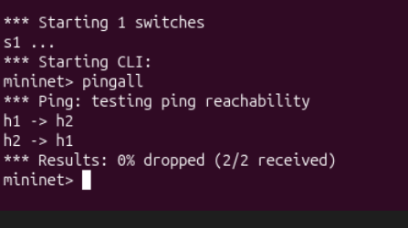
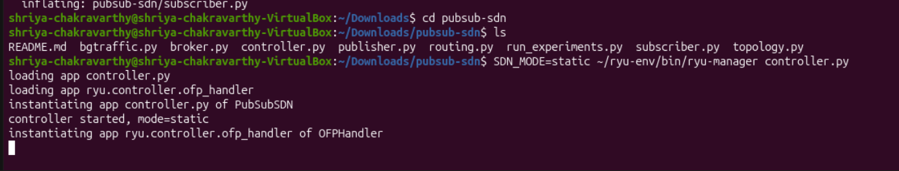
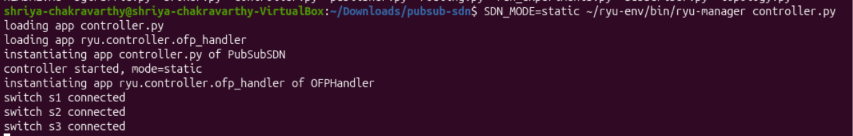
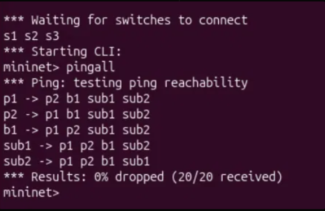
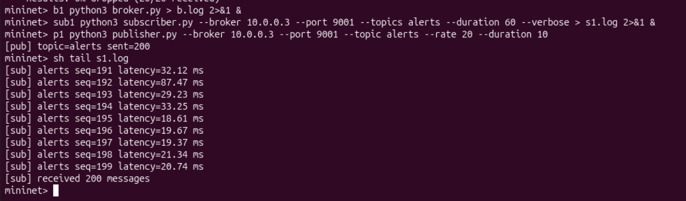
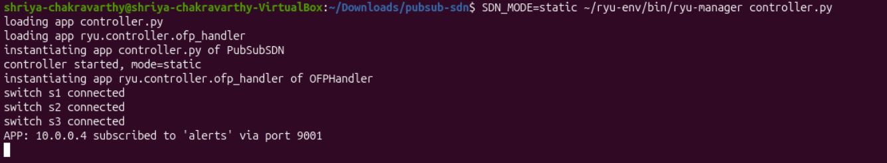
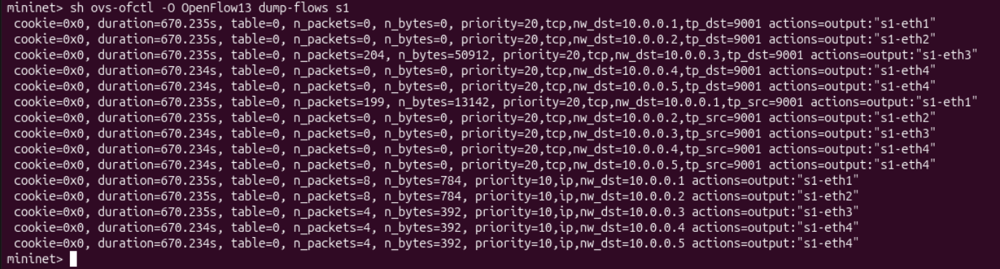
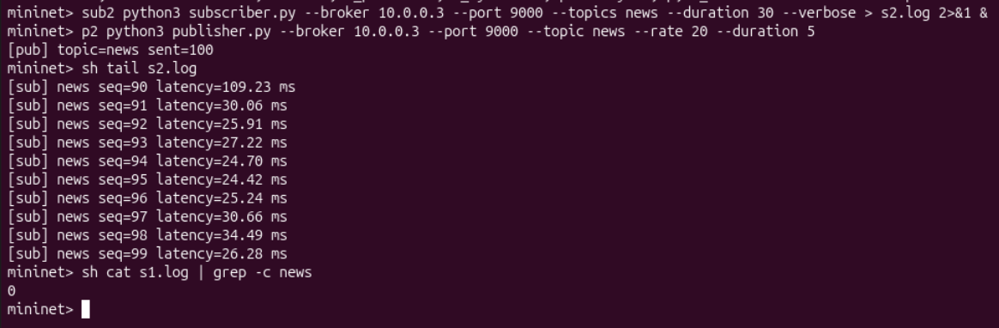

# Publish-Subscribe Messaging System over TCP + SDN (Mininet + Ryu)

Computer Networks (UE25CS243A) - Jackfruit mini project, topic 9.

Team: Shriya Chakravarthy(PES1UG25CS502), Ashu Verma(PES1UG25CS), Sorosij Mitra(PES1UG25CS)

## Project status
- **D1 (basic system, static SDN mode): complete and tested** - see "D1 test cases" below.
- **D2 (dynamic SDN, experiments, performance evaluation): code included, testing and results in progress.**

## 1. What is this project?

**Pub-Sub** = publishers send messages labelled with a *topic* (e.g. `alerts`) to a **broker**.
Subscribers tell the broker which topics they want; the broker forwards each message only to those subscribers.
Publishers and subscribers never talk to each other directly.

**TCP sockets** = the reliable byte-stream connections that publishers and subscribers use to talk to the broker.
Our messages are one JSON object per line (our application-layer protocol).

**SDN (Software Defined Networking)** = switches do not decide anything themselves. A central **controller**
(Ryu) tells each switch which flow rules to use (OpenFlow). So the controller can change the path of
traffic while the system runs.

**Mininet** = creates a virtual network (hosts + switches) on one VM so we can test all of this.

### Architecture

```
 p1 (alerts pub) -+                         +- sub1 (subscribes 'alerts' on port 9001)
                  s1 ==== 5 Mbps ==== s2 (b1 = BROKER)
 p2 (news pub)  --+     \            /
                         s3 --------+-- sub2 (subscribes 'news' on port 9000)
                    (alternate path s1-s3-s2)

              Ryu controller (OpenFlow 1.3)  <-- events from the broker (Unix socket)
```

- **Topic classes (traffic classification):** broker port **9000 = normal**, **9001 = priority**.
  The controller installs higher-priority flow entries for TCP port 9001.
- **Socket-SDN integration:** the broker tells the controller about every subscription, and about publishers that
  exceed a rate limit.
- **Dynamic SDN behaviour (D2, `SDN_MODE=dynamic`):**
  1. *Congestion:* polls port statistics every 2 s; if the s1-s2 link is loaded, priority traffic is moved to s1-s3-s2.
  2. *Link failure:* on an OpenFlow port-down event, all traffic is re-routed around the dead link.
  3. *Blocking:* when the broker reports a flooding publisher, the controller installs DROP rules for it.
- **Baseline (`SDN_MODE=static`):** installs the same initial rules but never changes them.

### Application-layer protocol

One JSON object per line, terminated by `\n`, over a TCP connection to the broker.

| Direction | Message | Meaning |
|---|---|---|
| client -> broker | `{"type":"SUB","topic":"alerts"}` | subscribe to a topic |
| client -> broker | `{"type":"UNSUB","topic":"alerts"}` | unsubscribe |
| client -> broker | `{"type":"PUB","topic":"alerts","payload":"...","seq":1,"ts":1.23}` | publish a message (`ts` = send time, used for latency) |
| broker -> client | `{"type":"ACK",...}` | subscribe / unsubscribe acknowledged |
| broker -> client | `{"type":"MSG","topic":...,"payload":...,"seq":...,"ts":...}` | message delivered to a subscriber |
| broker -> client | `{"type":"ERR","reason":"..."}` | bad request |

### Files

| File | What it does |
|---|---|
| `broker.py` | TCP broker, one thread per connection, topics, rate limit, notifies the controller |
| `publisher.py` / `subscriber.py` | Clients; messages carry a timestamp so subscribers measure latency |
| `bgtraffic.py` | UDP background traffic to congest a link (D2) |
| `routing.py` | Topology description and shortest-path computation |
| `controller.py` | Ryu SDN controller |
| `topology.py` | Mininet topology (3 switches, 5 hosts) |
| `run_experiments.py` | Runs static vs dynamic in 4 scenarios, writes `results/results.csv` (D2) |

## 2. Setup (Ubuntu VM)

Tested on Ubuntu 26.04 (Python 3.14) in VirtualBox. Ubuntu 22.04 also works.

```
# 1. Update and install Mininet
sudo apt update
sudo apt install mininet openvswitch-switch git curl python3-pip -y

# 2. Check Mininet (expect 0% dropped), then clean up
sudo mn
mininet> pingall
mininet> exit
sudo mn -c

# 3. Install the Ryu controller in its own Python 3.9 environment
#    (Ryu does not install on Python 3.12+)
curl -LsSf https://astral.sh/uv/install.sh | sh
#    close and reopen the terminal, then:
uv venv --python 3.9 ~/ryu-env
uv pip install --python ~/ryu-env/bin/python "setuptools==57.5.0" wheel pbr
uv pip install --python ~/ryu-env/bin/python --no-build-isolation "eventlet==0.30.2" ryu
~/ryu-env/bin/ryu-manager --version

# 4. Get the code
git clone <your-repo-url>
cd <repo-name>
```

## 3. D1 demo (basic system, static mode)

**Terminal 1 - controller** (leave it running):
```
SDN_MODE=static ~/ryu-env/bin/ryu-manager controller.py
```
Expected: `controller started, mode=static`, then `switch s1 connected` (and s2, s3).

**Terminal 2 - network** (same folder):
```
sudo python3 topology.py
mininet> pingall                    # expect 0% dropped (20/20)
mininet> b1 python3 broker.py > b.log 2>&1 &
mininet> sub1 python3 subscriber.py --broker 10.0.0.3 --port 9001 --topics alerts --duration 60 --verbose > s1.log 2>&1 &
mininet> p1 python3 publisher.py --broker 10.0.0.3 --port 9001 --topic alerts --rate 20 --duration 10
mininet> sh tail s1.log             # subscriber received 200 messages with latencies
mininet> sh ovs-ofctl -O OpenFlow13 dump-flows s1     # flow rules installed by the controller
```
Second topic, to show topic routing:
```
mininet> sub2 python3 subscriber.py --broker 10.0.0.3 --port 9000 --topics news --duration 30 --verbose > s2.log 2>&1 &
mininet> p2 python3 publisher.py --broker 10.0.0.3 --port 9000 --topic news --rate 20 --duration 5
mininet> sh tail s2.log
mininet> sh cat s1.log | grep -c news      # expect 0: the alerts subscriber never sees news
```
Clean up afterwards: `exit` in Mininet, Ctrl-C the controller, `sudo mn -c`.

## D1 test cases

| # | Test | How | Expected | Result |
|---|---|---|---|---|
| 1 | Network connectivity | `pingall` on the 5-host, 3-switch topology | 0% packet loss | Passed, 20/20 received |
| 2 | Controller connects to switches | Start Ryu, then Mininet | s1, s2, s3 connect | Passed |
| 3 | Pub-sub delivery | p1 publishes 200 `alerts` messages, sub1 subscribed | All 200 received | Passed, 200/200, latency about 20-30 ms |
| 4 | Topic routing | p2 publishes `news`, sub2 on `news`, sub1 on `alerts` | sub2 gets `news`, sub1 gets none | Passed |
| 5 | Multiple clients | 2 publishers, 2 subscribers on different topics | Both work at once | Passed |
| 6 | Traffic classification | `dump-flows` on s1 after the `alerts` run | Port 9001 matches priority-20 rules | Passed, 204 packets hit the broker rule |
| 7 | Socket-SDN integration | Subscribe to `alerts` | Controller logs the event | Passed: `APP: 10.0.0.4 subscribed to 'alerts' via port 9001` |

### Screenshots

**1. Mininet installation check** (`pingall` on the default 2-host topology, 0% dropped)



**2. Ryu controller started in static mode**



**3. All three switches (s1, s2, s3) connected to the controller**



**4. `pingall` on the project topology: 5 hosts, 0% dropped (20/20 received)**



**5. Pub-sub delivery: publisher sent 200 `alerts` messages, subscriber received 200, with per-message latency**



**6. Socket-SDN integration: the controller logs the broker's subscribe event**



**7. Flow rules on s1: priority-20 rules for TCP port 9001 (topic class) with packet counters, and priority-10 general rules**



**8. Topic routing: `news` subscriber receives `news`; the `alerts` subscriber received 0 `news` messages**



## 4. D2: dynamic SDN and experiments (in progress)

Start the controller with `SDN_MODE=dynamic`. Manual checks:
- **Link failure:** while a publisher runs, type `link s1 s2 down` in the Mininet CLI; the controller log prints
  `LINK DOWN ... re-routing` and messages keep arriving. Restore with `link s1 s2 up`.
- **Blocking:** `p2 python3 publisher.py --broker 10.0.0.3 --port 9000 --topic news --rate 3000 --duration 5`
  makes the broker print `BLOCK 10.0.0.2` and the controller install DROP rules.

Automated experiments (static vs dynamic, scenarios `normal`, `congestion`, `link_failure`, `flood`):
```
sudo RYU_MANAGER=$HOME/ryu-env/bin/ryu-manager python3 run_experiments.py --duration 20
```
Output: `results/results.csv`, `results/comparison.png`, per-run logs.
Metrics: mean and p95 latency of `alerts`, delivery ratio, longest gap between messages, rogue-host isolation.
Baseline = static mode (same rules, never updated); proposed = dynamic mode.

Results: _to be added after the experiments are run._

## 5. Troubleshooting

- `ryu-manager: command not found` -> use the full path `~/ryu-env/bin/ryu-manager`.
- Switch ports differ from `routing.py` -> `sudo ovs-ofctl -O OpenFlow13 show s1`; port 3 must go to s2 and port 4 to s3.
- Stale network state -> `sudo mn -c`. Port 6653 busy -> `sudo pkill -f ryu-manager`.
- `pingall` fails right after start -> wait 3-5 s for the switches to connect to the controller.
- No broker events in the controller log -> the broker and controller must run on the same VM (they use `/tmp/sdn_ctrl.sock`).

## 6. Design notes

- Why TCP? Reliable, ordered delivery; pub-sub messages must not be lost.
- How is concurrency handled? One thread per connection in the broker, and a lock per subscriber for sends.
- How does the controller know a topic's class? By TCP port (9001 vs 9000), with flow matches on `tcp_dst` / `tcp_src`.
- Why static ARP in the topology? The triangle has a loop; flooding ARP would loop without spanning tree.
- Why a Unix socket between broker and controller? It is an out-of-band control channel between the application and the controller.
- Limitations: latency uses one machine's clock (fine in Mininet); the rate limit is per publisher IP; the congestion threshold is tuned for the 5 Mbps bottleneck.
