 # Publish-Subscribe Messaging System over TCP + SDN (Mininet + Ryu)

Computer Networks (UE25CS243A) - Jackfruit mini project, topic 9.

Team: Shriya Chakravarthy, Ashu Verma, Sorosij Mitra

## Project status
- **D1 (basic system, static SDN mode): complete and tested** - see "D1 test cases".
- **D2 (dynamic SDN, challenging scenarios, performance evaluation): complete and tested** - see section 4.

## 1. What is this project?

**Pub-Sub** = publishers send messages labelled with a *topic* (e.g. `alerts`) to a **broker**.
Subscribers tell the broker which topics they want; the broker forwards each message only to those subscribers.
Publishers and subscribers never talk to each other directly.

**TCP sockets** = the reliable byte-stream connections that publishers and subscribers use to talk to the broker.
Our messages are one JSON object per line (our application-layer protocol).

**SDN (Software Defined Networking)** = switches do not decide anything themselves. A central **controller**
(Ryu) tells each switch which flow rules to use (OpenFlow). So the controller can change the path of
traffic while the system runs.

**Mininet** = creates a virtual network of hosts and switches on a single machine, so the whole system can be built and tested without physical hardware.

### Architecture

```
 p1 (alerts pub) -+                         +- sub1 (subscribes 'alerts' on port 9001)
                  s1 ==== 5 Mbps ==== s2 (b1 = BROKER)
 p2 (news pub)  --+     \            /
                         s3 --------+-- sub2 (subscribes 'news' on port 9000)
                    (alternate path s1-s3-s2)

              Ryu controller (OpenFlow 1.3)  <-- events from the broker (Unix socket)
```

- **Topic classes (traffic classification):** broker port **9000 = normal**, **9001 = priority**.
  The controller installs higher-priority flow entries for TCP port 9001.
- **Socket-SDN integration:** the broker tells the controller about every subscription, and about publishers that
  exceed a rate limit. In dynamic mode the controller acts on the rate-limit event.
- **Dynamic SDN behaviour (D2, `SDN_MODE=dynamic`):**
  1. *Congestion:* polls port statistics every 2 s; if a link is loaded (above 3 Mbps), the priority class (port 9001)
     is moved to the alternate path s1-s3-s2. It moves back when the load falls (below 1.5 Mbps).
  2. *Link failure:* on an OpenFlow port-down event, all traffic is re-routed around the dead link; on port-up the
     original paths are restored.
  3. *Blocking:* when the broker reports a publisher exceeding 500 msg/s, the controller installs DROP rules for that host.
- **Baseline (`SDN_MODE=static`):** installs the same initial rules but never changes them.

### Application-layer protocol

One JSON object per line, terminated by `\n`, over a TCP connection to the broker.

| Direction | Message | Meaning |
|---|---|---|
| client -> broker | `{"type":"SUB","topic":"alerts"}` | subscribe to a topic |
| client -> broker | `{"type":"UNSUB","topic":"alerts"}` | unsubscribe |
| client -> broker | `{"type":"PUB","topic":"alerts","payload":"...","seq":1,"ts":1.23}` | publish a message (`ts` = send time, used for latency) |
| broker -> client | `{"type":"ACK",...}` | subscribe / unsubscribe acknowledged |
| broker -> client | `{"type":"MSG","topic":...,"payload":...,"seq":...,"ts":...}` | message delivered to a subscriber |
| broker -> client | `{"type":"ERR","reason":"..."}` | bad request |

### Files

| File | What it does |
|---|---|
| `broker.py` | TCP broker, one thread per connection, topics, rate limit, notifies the controller |
| `publisher.py` / `subscriber.py` | Clients; messages carry a timestamp so subscribers measure latency |
| `bgtraffic.py` | UDP background traffic to congest a link (D2) |
| `routing.py` | Topology description and shortest-path computation |
| `controller.py` | Ryu SDN controller (static and dynamic modes) |
| `topology.py` | Mininet topology (3 switches, 5 hosts) |
| `run_experiments.py` | Runs static vs dynamic in 4 scenarios, writes `results/results.csv` (D2) |
| `plot_results.py` | Draws `results/comparison.png` from `results/results.csv` (D2) |

## 2. Setup (Ubuntu VM)

Developed and tested on Ubuntu 26.04 (Python 3.14) in a VirtualBox VM.

```
# 1. Update and install Mininet
sudo apt update
sudo apt install mininet openvswitch-switch git curl python3-pip python3-matplotlib -y

# 2. Check Mininet (expect 0% dropped), then clean up
sudo mn
mininet> pingall
mininet> exit
sudo mn -c

# 3. Install the Ryu controller in its own Python 3.9 environment
#    (Ryu does not install on Python 3.12+)
curl -LsSf https://astral.sh/uv/install.sh | sh
#    close and reopen the terminal, then:
uv venv --python 3.9 ~/ryu-env
uv pip install --python ~/ryu-env/bin/python "setuptools==57.5.0" wheel pbr
uv pip install --python ~/ryu-env/bin/python --no-build-isolation "eventlet==0.30.2" ryu
~/ryu-env/bin/ryu-manager --version

# 4. Get the code
git clone https://github.com/shriyachakra-byte/pubsub-sdn-mininet
cd pubsub-sdn-mininet
```

## 3. D1 demo (basic system, static mode)

**Terminal 1 - controller** (leave it running):
```
SDN_MODE=static ~/ryu-env/bin/ryu-manager controller.py
```
Expected: `controller started, mode=static`, then `switch s1 connected` (and s2, s3).

**Terminal 2 - network** (same folder):
```
sudo python3 topology.py
mininet> pingall                    # expect 0% dropped (20/20)
mininet> b1 python3 broker.py > b.log 2>&1 &
mininet> sub1 python3 subscriber.py --broker 10.0.0.3 --port 9001 --topics alerts --duration 60 --verbose > s1.log 2>&1 &
mininet> p1 python3 publisher.py --broker 10.0.0.3 --port 9001 --topic alerts --rate 20 --duration 10
mininet> sh tail s1.log             # subscriber received 200 messages with latencies
mininet> sh ovs-ofctl -O OpenFlow13 dump-flows s1     # flow rules installed by the controller
```
Second topic, to show topic routing:
```
mininet> sub2 python3 subscriber.py --broker 10.0.0.3 --port 9000 --topics news --duration 30 --verbose > s2.log 2>&1 &
mininet> p2 python3 publisher.py --broker 10.0.0.3 --port 9000 --topic news --rate 20 --duration 5
mininet> sh tail s2.log
mininet> sh cat s1.log | grep -c news      # expect 0: the alerts subscriber never sees news
```
Clean up afterwards: `exit` in Mininet, Ctrl-C the controller, `sudo mn -c`.

## D1 test cases

| # | Test | How | Expected | Result |
|---|---|---|---|---|
| 1 | Network connectivity | `pingall` on the 5-host, 3-switch topology | 0% packet loss | Passed, 20/20 received |
| 2 | Controller connects to switches | Start Ryu, then Mininet | s1, s2, s3 connect | Passed |
| 3 | Pub-sub delivery | p1 publishes 200 `alerts` messages, sub1 subscribed | All 200 received | Passed, 200/200, latency about 20-30 ms |
| 4 | Topic routing | p2 publishes `news`, sub2 on `news`, sub1 on `alerts` | sub2 gets `news`, sub1 gets none | Passed |
| 5 | Multiple clients | 2 publishers, 2 subscribers on different topics | Both work at once | Passed |
| 6 | Traffic classification | `dump-flows` on s1 after the `alerts` run | Port 9001 matches priority-20 rules | Passed, 204 packets hit the broker rule |
| 7 | Socket-SDN integration | Subscribe to `alerts` | Controller logs the event | Passed: `APP: 10.0.0.4 subscribed to 'alerts' via port 9001` |

### D1 screenshots

**1. Mininet installation check** (`pingall` on the default 2-host topology, 0% dropped)

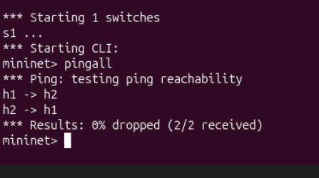

**2. Ryu controller started in static mode**

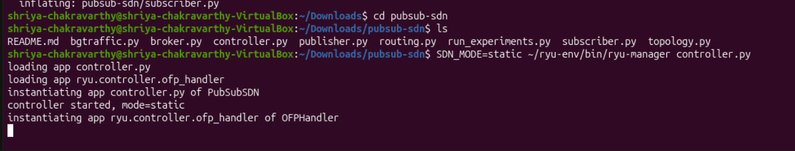

**3. All three switches (s1, s2, s3) connected to the controller**

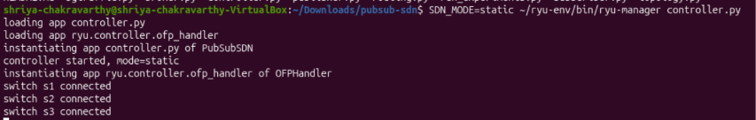

**4. `pingall` on the project topology: 5 hosts, 0% dropped (20/20 received)**

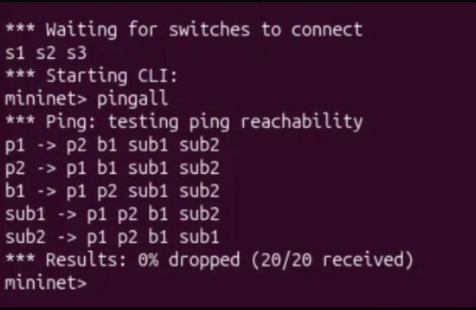

**5. Pub-sub delivery: publisher sent 200 `alerts` messages, subscriber received 200, with per-message latency**

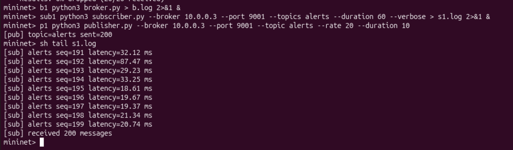

**6. Socket-SDN integration: the controller logs the broker's subscribe event**

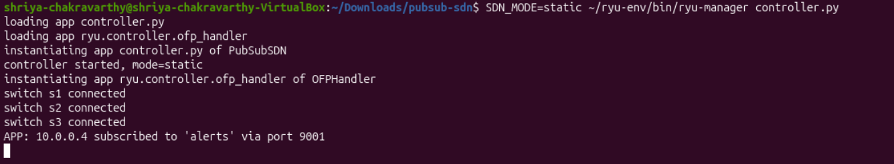

**7. Flow rules on s1: priority-20 rules for TCP port 9001 (topic class) with packet counters, and priority-10 general rules**

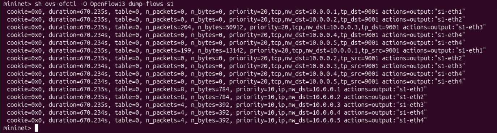

**8. Topic routing: `news` subscriber receives `news`; the `alerts` subscriber received 0 `news` messages**

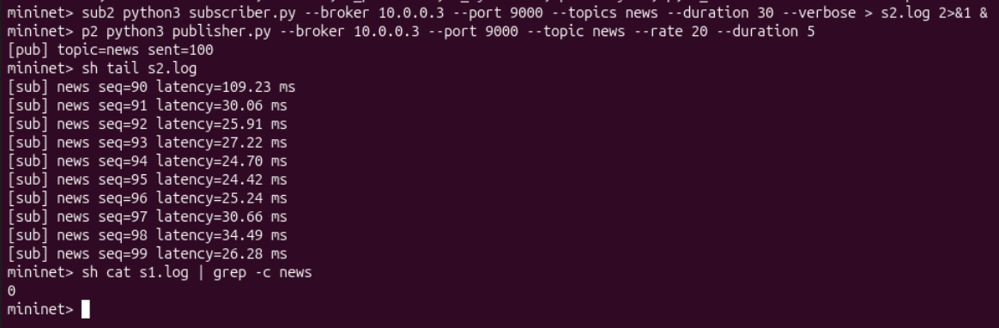

## 4. D2: dynamic SDN, challenging scenarios and performance evaluation

### 4.1 Running the dynamic mode
Start the controller with `SDN_MODE=dynamic` instead of `static`; everything else is the same as the D1 demo.
```
SDN_MODE=dynamic ~/ryu-env/bin/ryu-manager controller.py
```

### 4.2 Manual test cases (challenging scenarios)

| # | Scenario | How | Expected | Result |
|---|---|---|---|---|
| D2-1 | Dynamic mode starts and connects | Start controller with `SDN_MODE=dynamic`, then the topology | `mode=dynamic`, s1-s3 connected, `pingall` 0% dropped | Passed (screenshots 9, 10) |
| D2-2 | **Link failure** | p1 publishes 1200 `alerts` messages (20/s, 60 s); `link s1 s2 down` mid-stream, later `link s1 s2 up` | Controller reroutes; no message loss | Passed: controller logged `LINK DOWN [1, 2] -> re-routing` and `LINK UP [1, 2] -> restoring paths`; subscriber received **1200 of 1200** messages (screenshots 11, 12) |
| D2-3 | **Unauthorized / flooding publisher** | p2 publishes at 3000 msg/s | Broker detects the flood, controller blocks the host | Passed: broker logged `BLOCK 10.0.0.2: rate limit 500 msg/s exceeded`, controller logged `APP: BLOCK 10.0.0.2 ... -> installing DROP rules`, and `p2 ping b1` then showed **100% packet loss** (screenshots 13, 14) |

### 4.3 Automated experiments: static baseline vs dynamic SDN

Run (stops and starts the controller and network by itself, 8 runs, about 10 minutes):
```
sudo RYU_MANAGER=$HOME/ryu-env/bin/ryu-manager python3 run_experiments.py --duration 20
python3 plot_results.py        # draws results/comparison.png from results/results.csv
```

**Setup.** Publisher p1 sends `alerts` (priority port 9001) at 50 msg/s for 20 s to the broker; sub1 measures latency. The s1-s2 link is a 5 Mbps bottleneck; s1-s3-s2 is the alternate path.
Scenarios: **normal** (no disturbance); **congestion** (10 Mbps UDP background flow from p2 over the 5 Mbps link); **link_failure** (s1-s2 taken down after one third of the run); **flood** (a rogue publisher at 4000 msg/s, then a ping from the rogue host to the broker).
Baseline = `static` mode (same initial rules, never changed); proposed = `dynamic` mode.
Metrics: mean and 95th percentile latency (ms) of `alerts`, delivery ratio (received / sent), longest gap between received messages (s), and whether the rogue host is isolated (ping loss).

**Results** (`results/results.csv`):

| Scenario | Mode | Mean latency (ms) | p95 latency (ms) | Delivery | Longest gap (s) | Rogue host ping loss |
|---|---|---|---|---|---|---|
| normal | static | 24.80 | 38.88 | 1.00 | 0.09 | - |
| normal | dynamic | 23.78 | 37.04 | 1.00 | 0.10 | - |
| congestion | static | 11105.62 | 18031.28 | 1.00 | 18.13 | - |
| congestion | **dynamic** | **157.43** | **1278.26** | 1.00 | **1.78** | - |
| link_failure | static | 21.62 | 31.16 | **0.33** | 0.06 | - |
| link_failure | **dynamic** | 23.73 | 32.12 | **1.00** | 0.11 | - |
| flood | static | 38.02 | 114.41 | 1.00 | 0.21 | 0% (not isolated) |
| flood | **dynamic** | **24.60** | **49.18** | 1.00 | 0.11 | **100% (isolated)** |

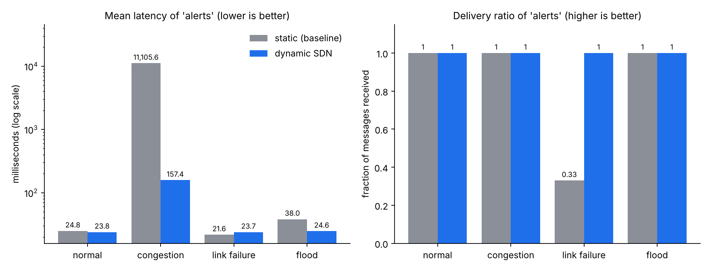

### 4.4 Analysis

- **Normal conditions:** both modes behave the same (about 24 ms). The small difference is within run-to-run noise, so the dynamic controller adds no visible cost when nothing goes wrong.
- **Congestion:** in static mode the priority traffic stays on the congested 5 Mbps link and queues behind the background flow, so mean latency reaches about 11 s (p95 18 s). In dynamic mode the controller detects the overloaded link from its port statistics and moves the priority class to the s1-s3-s2 path: mean latency drops to 157 ms (about **70x lower**), p95 to 1.3 s (about 14x lower), and the longest gap from 18 s to 1.8 s. The remaining delay is consistent with the 2-second statistics polling interval, since traffic is only moved once the congestion has been measured.
- **Link failure:** in static mode the rules are never updated, so after the link goes down the traffic is lost: only **33%** of messages arrive (roughly the one third sent before the failure). In dynamic mode the controller receives the port-down event, reroutes over s1-s3-s2, and **100%** of messages are delivered. The "longest gap" metric for static is misleading here (0.06 s) because it only measures gaps between messages that did arrive; the delivery ratio is the meaningful metric for this scenario.
- **Flood (unauthorized publisher):** in static mode the rogue host keeps sending, its ping to the broker still works (0% loss), and it degrades legitimate traffic (p95 114 ms). In dynamic mode the broker reports the flood, the controller installs DROP rules, the rogue host is fully isolated (100% ping loss), and the legitimate topic's latency stays low (p95 49 ms).

**Limitations.** Each configuration was run once for 20 s, so small differences (such as in the normal scenario) are within run-to-run noise; the effects in the congestion, link-failure and flood scenarios are much larger than that noise. Latency uses one machine's clock, which is valid inside Mininet. The congestion thresholds (3 Mbps / 1.5 Mbps) are tuned to the 5 Mbps bottleneck.

### 4.5 D2 screenshots

**9. Controller started in dynamic mode, all switches connected**

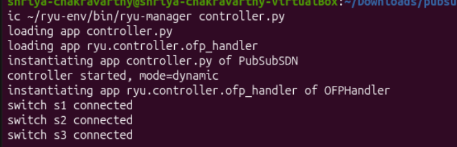

**10. `pingall` with the controller in dynamic mode (0% dropped)**

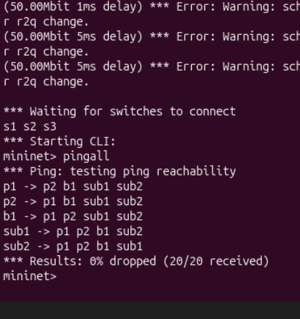

**11. Link failure: `link s1 s2 down` during publishing; the subscriber still received all 1200 messages**

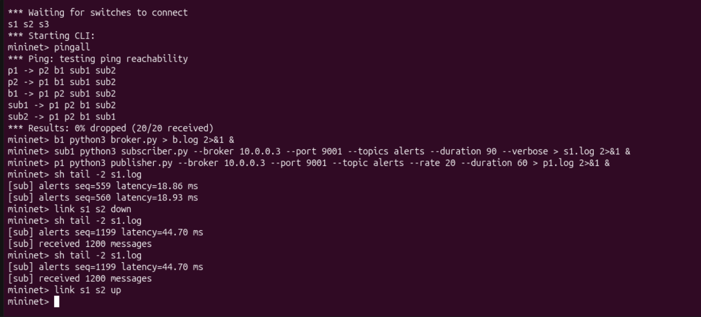

**12. Link failure: the controller logs `LINK DOWN [1, 2] -> re-routing` and `LINK UP [1, 2] -> restoring paths`**

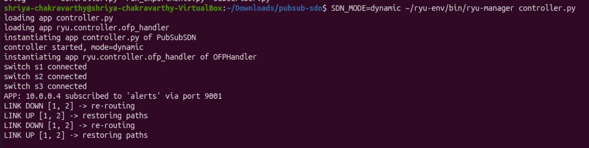

**13. Flooding publisher: the controller logs `APP: BLOCK 10.0.0.2 ... -> installing DROP rules`**

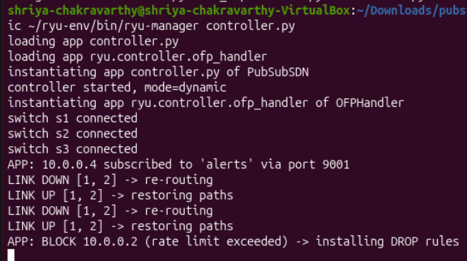

**14. Flooding publisher: the broker logs `BLOCK`, and the ping from p2 to the broker shows 100% packet loss**

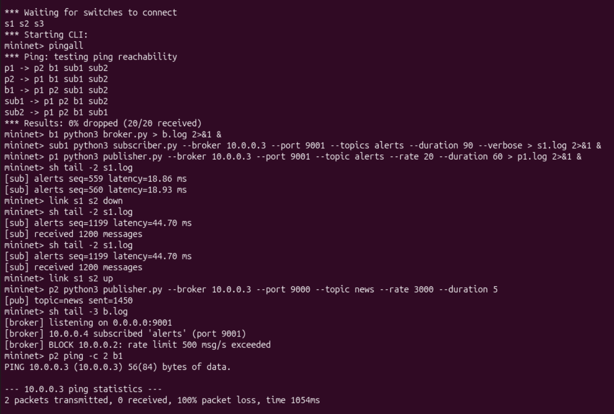

## 5. Troubleshooting

- `ryu-manager: command not found` -> use the full path `~/ryu-env/bin/ryu-manager`.
- Switch ports differ from `routing.py` -> `sudo ovs-ofctl -O OpenFlow13 show s1`; port 3 must go to s2 and port 4 to s3.
- Stale network state -> `sudo mn -c`. Port 6653 busy -> `sudo pkill -f ryu-manager`.
- `pingall` fails right after start -> the switches need 3-5 s to connect to the controller; run it again.
- No broker events in the controller log -> the broker and controller must run on the same VM (they use `/tmp/sdn_ctrl.sock`).
- `*** Error: Warning: sch_htb: quantum of class ... is big` -> harmless warning from Mininet's link-speed settings; no action needed.

## 6. Design notes

- Why TCP? Reliable, ordered delivery; pub-sub messages must not be lost.
- How is concurrency handled? One thread per connection in the broker, and a lock per subscriber for sends.
- How does the controller know a topic's class? By TCP port (9001 vs 9000), with flow matches on `tcp_dst` / `tcp_src`.
- How does the controller reroute? It keeps the set of failed and congested links and recomputes the shortest path avoiding them (`routing.py`), then reinstalls the flow rules on every switch.
- Why static ARP in the topology? The triangle has a loop; flooding ARP would loop without spanning tree.
- Why a Unix socket between broker and controller? It is an out-of-band control channel between the application and the controller.
- Limitations: latency uses one machine's clock (fine in Mininet); the rate limit is per publisher IP; the congestion threshold is tuned for the 5 Mbps bottleneck.
